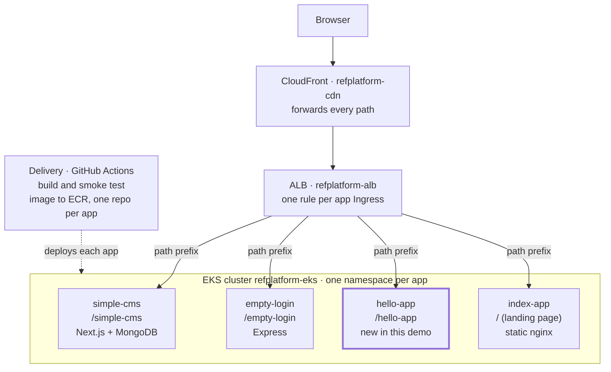

# RefPlatform

I Built My Own App Platform on AWS EKS — New App Live in 15 Minutes.
From Empty Folder to Live URL.

## Intro

I recently joined a frontend education course, and as any good frontend engineer, I brought my own production platform with me.

Every time I have an idea for a small app, it takes a day to build and then another one to host. New domain, new load balancer, new certificate, new pipeline, new secrets.

So I built the boring part once: AWS, Kubernetes, Terraform, GitHub Actions. Then adding an app is just a checklist. Stack is Kubernetes and AWS. Very practical. Very educational. Very normal.

This is RefPlatform. It's one EKS cluster in AWS. In front of it there's one Application Load Balancer and one CloudFront distribution. Every app gets its own path: slash simple-cms, slash empty-login, slash whatever I build next.

Terraform manages the infrastructure, and GitHub Actions builds and deploys the apps.

Each app has its own Kubernetes namespace with a resource quota, IAM role, ECR repository, Terraform state, and workflow. Apps that use secrets get their own Secrets Manager secret. Hello App starts without secrets.



Every request takes the same path down. The ALB picks the app by path prefix and order, and GitHub Actions deploys each app into its own namespace.

## Live platform

https://d1vqcl59m25vz.cloudfront.net

The landing page is static HTML served by nginx at `/`. Its links point to each app's path on the same hostname.

Demo app already on the platform:
https://d1vqcl59m25vz.cloudfront.net/simple-cms

Terminal:
```bash
kubectl get ns -l app.kubernetes.io/part-of=refplatform
kubectl -n simple-cms get deploy,pods,ingress
```

Under the hood, each app is a namespace. Simple CMS has its app pod and its MongoDB pod.

The repository keeps app code in `apps/`, infrastructure in `terraform/`, and workflows in `.github/workflows/`.

## Demo new app

The demo app is `hello-app`, an Express server at `/hello-app`.

The app name determines the path `/hello-app`, namespace `hello-app`, ECR repository `refplatform/hello-app`, and IAM role `refplatform-hello-app-irsa`.

### 1. Register the app and provision ECR

Open a registration-only PR from `main`. Add `hello-app` to [the platform registry](../terraform/eks/apps.tf) and reserve Ingress order `120` in the [architecture registry](architecture.md#route--order-registry-keep-current-orders-must-be-unique), the [Terraform app registry](../terraform/apps/README.md), and the [new-app guide](../apps/new-app/README.md). For an existing demo branch, take just those four files into the first PR. Keep the app files, workflow, and landing-page link for later merges.

Approve the `infra-eks` PR plan and check that it adds the ECR repository and lifecycle policy for `refplatform/hello-app`. Merge the PR, then approve the `infra-eks` apply on `main` in the `infra` environment. Wait for it to finish and verify the repository exists before pushing the branch that adds the app workflow.

```bash
aws ecr describe-repositories --region eu-central-1 \
  --repository-names refplatform/hello-app \
  --query 'repositories[0].repositoryUri' --output text
```

If `app-hello-app` already failed on the demo branch because the repository was missing, rerun that build after the ECR check passes.

### 2. Build and test the app locally

From the repository root on a branch based on the updated `main`, create the app directory and npm dependencies.

```bash
mkdir -p apps/hello-app
cd apps/hello-app
npm init -y
npm install express@5.3.0
```

Commit both `package.json` and `package-lock.json`. For a replay using the prepared app files, use the committed manifest and lockfile. Add `node_modules` and `.env*` to `.gitignore`.

Create `server.js` in `apps/hello-app`. The router serves the greeting and health check under `/hello-app`. The redirect at `/` makes the app easier to open locally.

```js
const express = require('express');

const BASE_PATH = '/hello-app';
const app = express();
app.disable('x-powered-by');
const site = express.Router();

site.get('/api/health', (req, res) => res.json({ status: 'ok' }));
site.get('/', (req, res) => {
  res.type('html').send(
    `<h1>Hello from RefPlatform</h1><p>Served at ${BASE_PATH}, pod ${process.env.HOSTNAME || 'local'}</p>`
  );
});

app.use(BASE_PATH, site);
app.get('/', (req, res) => res.redirect(302, `${BASE_PATH}/`));

const port = Number(process.env.PORT) || 3000;
const host = process.env.HOST || '0.0.0.0';
app.listen(port, host, () => console.log(`Serving at http://${host}:${port}${BASE_PATH}/`));
```

Create the `Dockerfile` and add `node_modules`, `.git`, and `.env*` to `.dockerignore`.

```dockerfile
FROM node:20-alpine
WORKDIR /app
ENV NODE_ENV=production
ENV PORT=3000
ENV HOST=0.0.0.0
COPY package.json package-lock.json ./
RUN npm ci --omit=dev && npm cache clean --force
COPY server.js ./
USER node
EXPOSE 3000
CMD ["node", "server.js"]
```

Run these commands from `apps/hello-app`. The health check should return `{"status":"ok"}` and the app URL should show the greeting.

```bash
docker build -t hello-app-local .
docker run --rm -d -p 127.0.0.1:3000:3000 --name hello-app-local hello-app-local
curl -fsS --retry 10 --retry-connrefused http://127.0.0.1:3000/hello-app/api/health
curl -fsS http://127.0.0.1:3000/hello-app/
docker rm -f hello-app-local
```

### 3. Add the app stack and deploy

Back at the repository root, use `terraform/apps/empty-login` as the template for [the Hello App Terraform root](../terraform/apps/hello-app/main.tf). Set the app name to `hello-app`, the path to `/hello-app`, the Ingress order to `120`, and the health path to `/hello-app/api/health`. Set the backend key to `apps/hello-app.tfstate` in [versions.tf](../terraform/apps/hello-app/versions.tf). Leave `secrets` empty for this demo.

Use `.github/workflows/app-empty-login.yml` as the template for [the Hello App workflow](../.github/workflows/app-hello-app.yml). Update the app name and path filters, and pass `/hello-app/api/health` to the build workflow.

Open a second PR with the app, its Terraform root, and its workflow. Check that the branch build passes, then merge to `main`. Wait for the `app-hello-app` workflow on `main` to finish successfully before checking the rollout and public URLs. CloudFront may briefly return `404` while the ALB picks up the route.

```bash
kubectl -n hello-app rollout status deployment/hello-app --timeout=120s
kubectl -n hello-app get deploy,pods,ingress
curl -fsS --retry 12 --retry-delay 5 --retry-all-errors \
  https://d1vqcl59m25vz.cloudfront.net/hello-app/api/health
curl -fsS https://d1vqcl59m25vz.cloudfront.net/hello-app/
```

### 4. Publish the landing-page link

Once both public checks pass, add the link in `apps/index-app/public/index.html` and merge the landing-page change to `main`.

```html
<li><a href="/hello-app/">Hello App</a>: greeting page for the app-onboarding demo</li>
```

Wait for `app-index-app` to deploy. Open the landing page and click **Hello App** to show the greeting and pod hostname.
